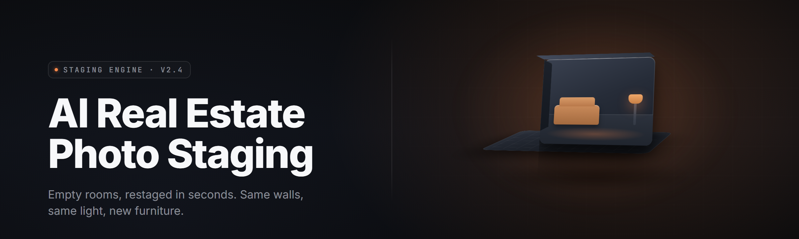

  
  
  

  

  
  
  

---

**Turn an empty living room snapped on a phone into a fully furnished, MLS-ready listing shot — in under forty seconds, offline, on your own GPU.**

I got tired of watching agents pay $8–$14 a photo to a staging service that returned the same beige sofa every time. So I built the thing I wanted: a single `.exe`, no cloud round-trips, no per-image billing, no account. Drop a photo in, pick a room type and a style pack, hit Generate, and get back a staged frame that still honors the room's real geometry — same window light, same door swing, same floor plane. Realty Stage AI Studio runs entirely on your machine. Your listing photos never leave your drive.

  

---

## 📋 Table of Contents

- [Tips for Best Results](#-tips-for-best-results)
- [All Modules Status](#-all-modules-status)
- [Comparison](#-comparison)
- [Usage Guidelines](#-usage-guidelines)
- [Overview](#-overview)
- [What is Virtual Staging?](#-what-is-virtual-staging)
- [Key Features](#-key-features)
- [The Problem](#-the-problem)
- [The Solution](#-the-solution)
- [Quick Start](#-quick-start)
- [Feature Modules by Category](#-feature-modules-by-category)
- [System Requirements](#-system-requirements)
- [Installation](#-installation)
- [Known Issues](#-known-issues)
- [FAQ](#-faq)

---

## 💡 Tips for Best Results

- Shoot from a corner at chest height — wide, level, no tilt. The geometry solver locks in faster on level horizons.
- Turn every light on and open the blinds. The relighting pass reads existing light direction; it can't invent a source that isn't there.
- Keep the frame clear of your own reflection, fingers, and clutter you don't want preserved. The masker preserves what it sees.
- One room per photo. Wide-open floorplans confuse the room-type classifier — crop to a single space.
- Use `RAW` or full-resolution `JPEG`, minimum 2048px on the long edge. Staging a 640px thumbnail produces mushy furniture.
- Set the room type manually if the auto-classifier guesses wrong. It's one click and it fixes 90% of odd results.
- For exteriors, shoot at golden hour and enable the `Curb Appeal` style pack — the lawn and sky passes are tuned for warm light.

---

## 🧩 All Modules Status

| Module | Status | Description |
| --- | --- | --- |
| Room Geometry Solver | ✅ Working | Estimates floor plane, wall lines, and vanishing points from a single frame |
| Depth Estimator (v2.3) | ✅ Working | Monocular depth map used to place furniture at correct scale |
| Furniture Compositor | ✅ Working | Lays in staged assets that respect the solved floor plane and occlusion |
| Relighting Engine | ✅ Working | Matches generated assets to the photo's real light direction and color temp |
| Shadow Baker | ✅ Working | Contact shadows under every placed object, tied to the light solve |
| Room-Type Classifier | ✅ Working | 14 classes: living, bedroom, kitchen, bath, office, dining, exterior, and more |
| Style Pack Loader | ✅ Working | Loads `.stagepack` style bundles; 9 shipped, custom packs supported |
| Sky Replacement | ✅ Working | Exterior sky swap with horizon-aware blending |
| Lawn & Landscaping Pass | ✅ Working | Curb-appeal grass, hedge, and path enhancement for exteriors |
| Window Pull | ✅ Working | Recovers blown-out window detail for interior realism |
| Declutter Mask | ✅ Working | Auto-detects and dims small clutter without touching architecture |
| Perspective Correct | ✅ Working | Straightens mild lens distortion and keystone before compositing |
| Batch Queue | ✅ Working | Drop a folder, stage a whole listing unattended |
| EXIF Passthrough | ✅ Working | Preserves original capture metadata on export |
| Watermark Layer | ✅ Working | Optional team logo or MLS watermark with position control |
| Color Grade Presets | ✅ Working | 11 neutral grades that keep whites honest for listing compliance |
| Real-Estate Compliance Check | ✅ Working | Flags obvious over-staging that could trip disclosure rules |
| Undo Stack (per image) | ✅ Working | 50-step non-destructive history per frame |
| GPU Backend Selector | ✅ Working | CUDA, DirectML, or CPU fallback, auto-detected |
| Model Cache Manager | ✅ Working | Manages downloaded model weights, verified by hash |
| Preset Save/Load | ✅ Working | Save a full room + style + settings combo as a one-click preset |
| Export Profiles | ✅ Working | MLS, Zillow-optimized, print, and web sizes |
| Before/After Slider | ✅ Working | In-app comparison with synchronized pan and zoom |
| Metadata Stripper | ✅ Working | Optional GPS and device scrub on export |
| Style Mixer | ✅ Working | Blend two style packs by weight for custom looks |
| Furniture Swap | ✅ Working | Click any placed object to cycle alternate assets |
| Manual Mask Brush | ✅ Working | Paint regions to protect from staging or force re-staging |
| Light Source Pin | ✅ Working | Manually pin the dominant light when auto-solve drifts |
| Reference Match | ✅ Working | Upload a target look; the tool nudges grade and assets toward it |
| Multi-Room Consistency | ✅ Working | Carries style and grade across a listing's photos |
| Lens/Camera Profiles | ✅ Working | Corrects common phone and DSLR lens signatures |
| HDR Merge Input | ✅ Working | Accepts bracketed shots as a single staging source |
| Region Upscale | ✅ Working | Detail-preserving upscale of the staged region only |
| Tiling Preview | ✅ Working | Renders large prints in tiles to save VRAM |
| Style Pack Editor | ✅ Working | Author and export your own `.stagepack` bundles |
| Clutter Asset Library | ✅ Working | 400+ optional decor props you can drop manually |
| Disclosure Stamp | ✅ Working | Optional "virtually staged" tag baked or layered on export |
| Crash-Safe Autosave | ✅ Working | Per-frame autosave so a long batch survives a power blip |
| Telemetry Off by Default | ✅ Working | No network calls unless updates are explicitly enabled |

---

## ⚖️ Comparison

| Aspect | Traditional Staging Service | Stock AI Image Tools | This Tool |
| --- | --- | --- | --- |
| Cost model | $8–$14 per photo | Subscription, per-seat | One-time, no per-image fee |
| Turnaround | 24–72 hours | Minutes, but manual | ~40 seconds per frame, batchable |
| Privacy | Photos uploaded to vendor | Photos uploaded to cloud | Fully offline on your GPU |
| Geometry accuracy | Human stager, high | Often ignores room lines | Solves floor plane + occlusion |
| Light matching | Photographer re-shoots | Generic relight | Reads source light direction |
| Batch a whole listing | Per-photo billing | Manual, one at a time | Folder queue, unattended |
| Style consistency | Stager's taste | Inconsistent per prompt | Style packs + multi-room carry |

---

## ✅ Usage Guidelines

| Allowed | Not allowed |
| --- | --- |
| Staging your own listing photos | Claiming staged furniture physically exists in the home |
| Flipping houses and marketing renders | Removing required disclosure where your state mandates one |
| Real-estate marketing and portal listings | Bulk-generating deceptive "as-is" condition photos |
| Educational and hobbyist experimentation | Reselling staged output as an unstaged original |
| Authoring and sharing custom `.stagepack` files | Bundling model weights you don't have rights to distribute |

---

## 🗂️ Overview

| Category | Details |
| --- | --- |
| Product name | Realty Stage AI Studio |
| Type | Offline AI virtual staging desktop app |
| Platform | Windows 10 / 11 (x64) |
| Runtime | Standalone `.exe`, no pip, no npm, no git |
| Inference | Local GPU (CUDA / DirectML) or CPU fallback |
| Network | None required; updates opt-in |
| Input | JPEG, PNG, TIFF, HDR brackets |
| Output | JPEG, PNG, WebP, TIFF with selectable profiles |
| Year | 2026 |

Realty Stage AI Studio is a desktop application for realtors, flippers, and property marketers who want listing photos staged without a subscription or a cloud upload. It bundles the whole pipeline — geometry solving, depth estimation, furniture compositing, relighting, and export — into a single executable you extract and run. No accounts, no per-image billing, no data leaving your machine.

---

## 🛋️ What is Virtual Staging?

| Term | Explanation |
| --- | --- |
| Virtual staging | Digitally furnishing an empty or sparse room in a photo so buyers can visualize the space |
| Style pack | A bundled set of furniture assets, materials, and grade settings applied to a room |
| Floor plane solve | Estimating the ground plane from perspective lines so furniture sits at correct scale |
| Relighting | Recomputing lighting on generated assets to match the photo's real light direction |
| Occlusion | Correctly hiding parts of placed objects behind real walls or furniture in the shot |
| Curb appeal pass | Exterior-only enhancement of lawn, sky, and landscaping |
| Disclosure stamp | An on-image marker noting the photo is virtually staged |

**Why it matters for a listing:**

- Empty rooms photograph smaller and read as cold — staged rooms photograph bigger and hold attention longer.
- Buyers scrolling a portal decide in seconds; a furnished hero shot wins the click.
- Per-photo staging services bill every image, every revision — offline staging costs nothing per frame.
- Consistency across a listing's photos builds trust; mismatched furniture looks careless.
- Privacy: seller interiors stay on your drive, never on a vendor's servers.
- Speed: a whole listing staged before your coffee goes cold.

---

## 🧠 Key Features

| Feature | Description | Benefit |
| --- | --- | --- |
| Offline inference | All models run locally on your GPU | No uploads, no accounts |
| Geometry solver | Solves floor plane and wall lines per frame | Furniture sits at believable scale |
| Style packs | 9 shipped bundles plus custom authoring | Consistent looks across listings |
| Batch queue | Stage an entire folder unattended | Whole-listing turnaround in minutes |
| Relighting | Matched to source light direction | Staged objects blend into the photo |
| Multi-room carry | Style and grade follow a listing | No mismatched rooms |
| Furniture swap | Click to cycle alternate assets | Dial in the look without regenerating |
| Manual masks | Protect or force regions by brush | Fix odd auto-masks instantly |
| Reference match | Upload a target look to nudge toward | Match a client's moodboard |
| Export profiles | MLS, Zillow-optimized, print, web | One click, portal-ready output |
| Disclosure stamp | Optional "virtually staged" tag | Stay compliant where required |
| Non-destructive undo | 50-step per-frame history | Experiment freely |

---

## 🔧 The Problem

- **Staging is expensive per photo.** Professional virtual staging bills $8–$14 per image, and every revision is another line item.
- **Cloud tools leak seller privacy.** Uploading interiors to a vendor means interiors live on someone else's server.
- **Stock AI editors ignore geometry.** Generic image models drop furniture through walls and float couches halfway up the frame.
- **Lighting never matches.** A sofa relit with the wrong direction reads as a pasted sticker, not a furnished room.
- **Listings arrive with mixed styles.** Per-photo tools produce a different look in every room, and buyers notice.
- **Turnaround kills momentum.** A 24–72 hour staging queue means a listing goes live stale.
- **No offline option.** Most tools require an account and an internet connection just to open a photo.

---

## 🛠️ The Solution

| Problem | Solution |
| --- | --- |
| Per-photo billing | One-time app, unlimited local staging |
| Cloud privacy risk | Fully offline inference on your GPU |
| Ignored geometry | Per-frame floor-plane and occlusion solve |
| Mismatched lighting | Source-light relighting and shadow baking |
| Mixed styles across a listing | Style packs with multi-room carry |
| Slow turnaround | ~40s per frame, folder batch queue |
| Account-gated tools | Single `.exe`, extract and run |

---

## 🚀 Quick Start

1. 🧭 **Visit the project page** — read the overview and grab the Windows build.
2. ⬇️ **Download** the archive using the button below.
3. 📦 **Extract** the archive to any folder — Desktop is fine.
4. ▶️ **Run the `.exe`** — no installer, no dependencies to fetch.
5. 🖼️ **Drop in a photo**, pick a room type and style pack, and hit **Generate**.

  

---

## 🧰 Feature Modules by Category

### 🛏️ Staging Core

| Feature | Effect |
| --- | --- |
| Floor-plane solve | Places furniture at believable scale and depth |
| Occlusion pass | Hides objects behind real walls and existing furniture |
| Furniture compositor | Lays in staged assets matched to room type |
| Furniture swap | Cycles alternate assets without full regeneration |

### 💡 Lighting & Realism

| Feature | Effect |
| --- | --- |
| Relighting engine | Matches generated light to the photo's source direction |
| Shadow baker | Adds grounded contact shadows under every object |
| Window pull | Recovers blown window detail for believable interiors |
| Light source pin | Lets you correct auto-solve when it drifts |

### 🏡 Exterior & Curb Appeal

| Feature | Effect |
| --- | --- |
| Sky replacement | Horizon-aware sky swap for exteriors |
| Landscaping pass | Enhances lawn, hedge, and path details |
| Golden-hour grade | Warms exterior output for listing appeal |
| Reflection cleanup | Tidies window and door glass reflections |

### 🎨 Styles & Consistency

| Feature | Effect |
| --- | --- |
| Style packs | 9 shipped looks, one click to apply |
| Style mixer | Blends two packs by weight for a custom look |
| Multi-room carry | Keeps grade and style uniform across a listing |
| Reference match | Nudges output toward an uploaded target look |

### 🗃️ Workflow & Batch

| Feature | Effect |
| --- | --- |
| Batch queue | Stages a whole folder unattended |
| Preset save/load | Recall a room + style + settings combo in one click |
| Non-destructive undo | 50-step history per frame |
| Crash-safe autosave | Survives a power blip mid-batch |

### 📤 Export & Compliance

| Feature | Effect |
| --- | --- |
| Export profiles | MLS, Zillow-optimized, print, and web presets |
| Disclosure stamp | Optional "virtually staged" tag baked or layered |
| Metadata stripper | Optional GPS and device scrub on export |
| EXIF passthrough | Preserves original capture metadata when wanted |

---

## 💻 System Requirements

| Component | Minimum | Recommended |
| --- | --- | --- |
| OS | Windows 10 x64 (21H2+) | Windows 11 x64 |
| CPU | 4-core, SSE4.2 | 8-core modern |
| RAM | 8 GB | 16 GB or more |
| GPU | Integrated, 2 GB VRAM | NVIDIA 8 GB VRAM (CUDA) or DirectML GPU |
| Disk | 6 GB free (models) | 12 GB free on SSD |
| Display | 1280×720 | 1920×1080 or higher |
| Input | Any JPEG/PNG/TIFF | RAW or HDR brackets |

---

## 📥 Installation

1. **Extract the archive.** Right-click the downloaded `.zip` and choose *Extract All*. Avoid running directly from inside the zip — the model cache needs a writable folder.
2. **Run the `.exe`.** Double-click the executable in the extracted folder. Windows SmartScreen may warn on first launch — choose *More info* → *Run anyway*, since the build is unsigned community software.
3. **Let the model cache warm up.** On first launch the app verifies and unpacks local model weights into a `models/` folder beside the `.exe`. This is a one-time step and needs no internet.

> If your GPU is unsupported, the app automatically falls back to CPU inference. Expect roughly 4–6× longer per frame on CPU.

---

## 🐞 Known Issues

| Issue | Solution |
| --- | --- |
| Auto room-type guess is wrong | Set the room type manually in the right panel — one click fixes it |
| Furniture floats in odd shots | Pin the light source manually and re-run the geometry solve |
| Batch stalls on one image | Corrupt or tiny files halve the queue speed — remove and re-run |
| Exterior sky blends hard | Enable horizon-aware blending in the Sky Replacement module |
| CPU fallback feels slow | Lower the region-upscale setting or switch to a GPU backend |
| First launch re-verifies models | Antivirus touching the `models/` folder forces a re-hash — add an exclusion |

---

## ❓ FAQ

**Q:** Does the app upload my photos anywhere?
**A:** No. All inference runs locally. The only optional network call is an update check, which is off by default.

**Q:** Do I need Python, Node, or Git?
**A:** None of them. Download, extract, run the `.exe`. The bundled runtime handles everything.

**Q:** Will it run without a dedicated GPU?
**A:** Yes. It falls back to CPU inference, just slower — expect 4–6× the per-frame time.

**Q:** Can I make my own style packs?
**A:** Yes. The Style Pack Editor authors and exports `.stagepack` bundles you can share.

**Q:** Does it strip my camera metadata?
**A:** Only if you enable the Metadata Stripper on export. By default EXIF is passed through.

**Q:** Can it stage a whole listing at once?
**A:** Yes — drop the folder into the Batch Queue and it stages every image unattended.

**Q:** Do I need an internet connection?
**A:** No. The app is fully offline after extraction. Updates are opt-in.

**Q:** Is the disclosure stamp required?
**A:** It depends on your state and MLS rules. The app gives you the option; compliance is your call.

**Q:** What formats can I feed it?
**A:** JPEG, PNG, TIFF, and HDR brackets. RAW is supported through the lens-profile import path.

**Q:** Does it work on macOS or Linux?
**A:** The shipped build is Windows-only. The pipeline is portable, but there's no packaged macOS/Linux binary yet.

---

Realty Stage AI Studio is the tool I wanted when I was staring at a listing that went live a week late because staging was stuck in a queue. It keeps the seller's interiors private, honors the room's real geometry, and costs nothing per frame. Extract it, run it, and stage a whole listing before the showing. Absolute potato to Sam — this one ships.

  

